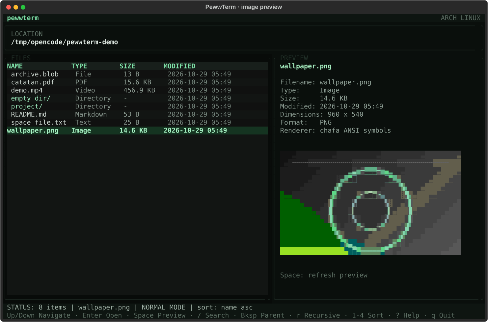
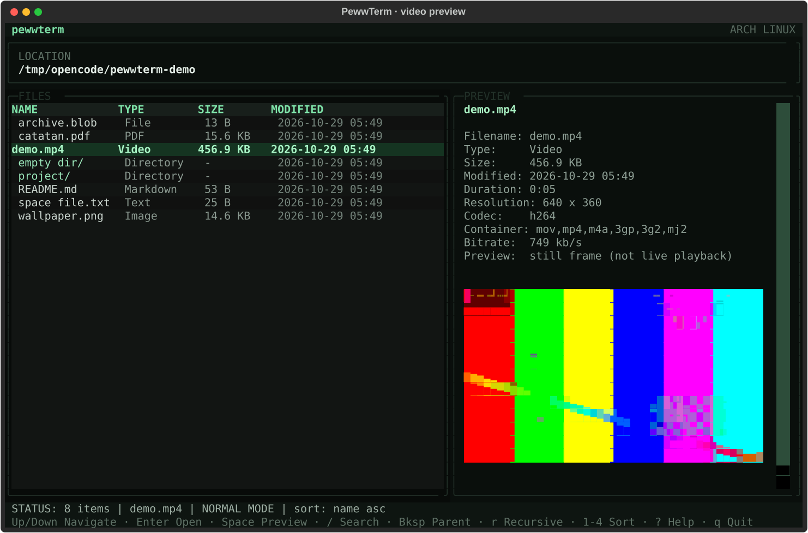
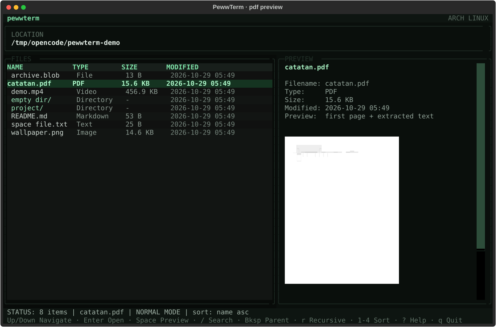

# PewwTerm


A keyboard-driven multimedia file explorer for the terminal on Arch Linux.
PewwTerm browses directories, previews images, videos, PDFs, Markdown and source
code, and hands videos to `mpv` for real playback. It is a file browser, not a
shell replacement.



| Video still frame | PDF text and first page |
| --- | --- |
|  |  |

More screenshots: [file browser](demo/screenshots/01-files.svg),
[search](demo/screenshots/05-search.svg),
[keyboard help](demo/screenshots/06-help.svg), and the
[narrow layout](demo/screenshots/07-narrow.svg).

## Documentation

Start with the [documentation index](docs/index.md), or jump to:

- [Installation](docs/installation.md)
- [Usage and keyboard shortcuts](docs/usage.md)
- [Previews, tools and cache](docs/previews.md)
- [Architecture](docs/architecture.md)
- [Development and testing](docs/development.md)
- [Troubleshooting](docs/troubleshooting.md)

## Features

- One-dimensional file list rendered with Textual's `DataTable`.
- Responsive split view: file table plus preview, or full-width table below
  `96` columns.
- Case-insensitive partial filename search with optional recursive traversal.
- Sorting by name, size, type or modification time, with reversible order.
- Directory symlinks are entered in place, so Backspace returns to the directory
  containing the link rather than jumping to the link target's parent.
- Image previews through `chafa` ANSI symbols, with a Pillow ASCII fallback.
- Video metadata through `ffprobe` and a cached still frame through `ffmpeg`.
- PDF text through `pdftotext` and a cached first-page thumbnail through
  `pdftoppm`.
- Bounded text and Markdown previews; binary files are detected and labelled.
- External playback with `mpv`, using the terminal suspend/resume cycle.
- Background worker threads keep the interface responsive during FFmpeg,
  Poppler and recursive traversal work.
- Missing optional tools never crash the application; the preview panel explains
  which capability is unavailable.
- Safe bounded preview calls: argument lists only, no shell, timeouts, bounded
  output.

## Requirements

- Python 3.10 or newer (tested on 3.10.16, 3.12.8 and 3.14.5).
- A 256-color terminal; a Unicode-capable font is recommended for Chafa art.
- Python packages: Textual 8.x, Rich 13+, Pillow 10+.
- Optional Arch Linux packages:

```bash
sudo pacman -S --needed chafa ffmpeg poppler mpv
```

| Tool | Used for | Without it |
| --- | --- | --- |
| `chafa` | ANSI image/video/PDF art | Pillow ASCII fallback where possible |
| `ffmpeg` | video still frames | video metadata only, no thumbnail |
| `ffprobe` | video metadata | preview without duration/resolution |
| `pdftotext` | PDF text | first-page art only, if available |
| `pdftoppm` | PDF page thumbnails | extracted text only |
| `mpv` | actual video playback | `p` / Enter reports that playback is disabled |

## Install

From this repository:

```bash
cd pewwterm
python -m venv .venv
source .venv/bin/activate
pip install -e .
```

For tests and development tooling:

```bash
pip install -e '.[dev]'
```

Check external tools without starting the interface:

```bash
pewwterm --check
```

The same command is available as `python -m pewwterm --check`.

## Run

```bash
pewwterm                 # open the current directory
pewwterm ~/Videos        # open a directory
pewwterm ~/Videos/clip.mp4   # open its parent and select the file
pewwterm --check         # dependency report
pewwterm --version
```

## Keyboard shortcuts

| Key | Action |
| --- | --- |
| `Up` / `Down` | Move the file selection |
| `Enter` | Open a directory, play a video, or refresh a file preview |
| `Backspace` | Go to the parent directory |
| `Space` | Reload the selected file's preview |
| `/` | Open search (in the current directory or recursively) |
| `type` | Case-insensitive partial filename matching |
| `Up` / `Down` in search | Select a search result while the query keeps focus |
| `Enter` in search | Open the selected result |
| `Esc` | Clear the query; press again to close search |
| `r` | Toggle recursive search before opening the search box |
| `Ctrl+R` | Toggle recursive search while typing and rerun the query |
| `1` | Sort by name |
| `2` | Sort by size |
| `3` | Sort by type |
| `4` | Sort by modification time |
| `o` | Reverse the current sort order |
| `p` | Play the selected video with `mpv` |
| `?` | Show keyboard and dependency help |
| `q` / `Ctrl+Q` | Quit |

Inside the search box, printable keys are text. That is why recursive search is
also bound to `Ctrl+R` while typing; otherwise the letter `r` must remain usable
in a filename query.

## Preview behaviour

| Selection | Preview |
| --- | --- |
| Directory | Entry counts and an open instruction; contents are not recursively sized |
| Image | Pillow metadata plus Chafa ANSI symbols, or Pillow ASCII fallback |
| Video | Duration, resolution, codec, container, bitrate, cached still frame |
| PDF | Extracted text from the first three pages plus optional first-page art |
| Markdown | Bounded UTF-8 text rendered as Markdown |
| Text / code | Bounded UTF-8 source text |
| Other | Metadata and a note that the file remains available to external tools |

Previews are explicitly still images. Only `mpv` performs real video playback.
PDF thumbnails and video frames are cached under:

```text
$PEWWTERM_CACHE_DIR            # if set
$XDG_CACHE_HOME/pewwterm       # otherwise
~/.cache/pewwterm              # default
```

The cache key includes the resolved path, file size and modification timestamp,
so replacing a file invalidates its old preview.

## Search, sorting and traversal

The browser stores its current rows as a single `list[FileRecord]`. A row index
is an index into that list; sorting returns a new list with a stable name
tie-breaker.

- `linear_search` compares a case-folded substring against every filename and
  returns all matches. This is what the interactive search box uses.
- `binary_search` and `binary_search_all` perform exact-name lookups on a sorted
  sequence in `O(log n)`, with a validation pass that raises `ValueError` for
  unsorted input.
- Recursive search walks directories with a `(st_dev, st_ino)` visited set,
  skips symlink loops, does not follow directory symlinks by default, and skips
  unreadable entries. It is bounded to depth 24 and 3000 results.
- The UI records traversal issues (permission denied, disappearing entries,
  loop skips) and shows a short note instead of failing the whole search.

## Architecture

```text
src/pewwterm/
  __main__.py          CLI, --check, --version
  app.py               Textual UI, key bindings, workers, responsive layout
  config.py            constants, tool discovery, cache directory
  models.py            FileRecord, classification, list sorting, formatting
  search.py            linear and binary filename search
  traversal.py         recursive walk with loop and depth safeguards
  image_preview.py     Chafa rendering plus Pillow metadata/ASCII fallback
  video_preview.py     FFprobe metadata and cached FFmpeg still frames
  document_preview.py  bounded text, pdftotext and pdftoppm helpers
  player.py            suspended-terminal MPV playback
  preview.py           UI-agnostic preview dispatcher
tests/                 unit and Textual integration tests
docs/                  installation, usage, previews and architecture guides
demo/capture_screens.py deterministic SVG screenshot generator
.github/               CI workflow and issue/pull-request templates
```

All potentially blocking preview work runs through `asyncio.to_thread` in an
exclusive Textual worker. A monotonic preview token prevents a slow, outdated
worker from replacing a newer selection. Preview subprocesses use argument
lists, captured output, `check=False` and a 20-second timeout. `mpv` is
interactive: the terminal is suspended for it, its output is not captured and
playback is not time-limited.

## Testing and verification

Run the test suite and linter:

```bash
.venv/bin/pytest -q
.venv/bin/python -m ruff check src tests demo/capture_screens.py
```

Recorded result on Arch Linux with Python 3.14.5:

```text
........................................................................ [ 71%]
.............................                                            [100%]
104 passed in 28.95s
```

```text
All checks passed!
```

The suite covers filesystem classification and formatting, linear/binary search,
recursive traversal and symlink loops, preview dispatch and external-tool failure
paths, MPV argument construction, the Textual application, relative and symlinked
path selection, search selection, sorting, responsive layout, error-state
recovery, cache fallback, and keyboard bindings. See
[the development guide](docs/development.md) for the full contributor workflow
and screenshot generation.

Real Chafa, FFmpeg and Poppler previews were additionally verified manually
against sample PNG, MP4 and PDF files, together with live navigation, search,
recursive search, parent navigation, help, sorting, responsive layout and quit in
a tmux terminal. Actual `mpv` playback was not launched in the headless capture
environment; MPV command construction and failure paths are covered by tests,
and the `p` shortcut is tested with an injected player.

Dependency check recorded in this environment:

```text
python     available  /home/user/pewwterm/.venv/bin/python
chafa      available  /usr/bin/chafa
ffmpeg     available  /usr/bin/ffmpeg
ffprobe    available  /usr/bin/ffprobe
pdftotext  available  /usr/bin/pdftotext
pdftoppm   available  /usr/bin/pdftoppm
mpv        available  /usr/bin/mpv
cache      /home/user/.cache/pewwterm
```

The screenshots in `demo/screenshots/` were generated from real previews with
the Textual test driver:

```bash
.venv/bin/python demo/capture_screens.py /path/to/media --output demo/screenshots
```

## Troubleshooting

**A dependency is listed as MISSING.** Install it from the table above. The
browser still starts; only the affected preview capability is reduced.

**Stray characters or unexpected sort changes under tmux.** PewwTerm invokes
Chafa with `--probe off`. Chafa's default terminal probing waits for capability
replies such as window-size reports, and those replies can otherwise be consumed
as keyboard input. If you see this with a custom build, make sure the flag is
present.

**Image art looks like monochrome characters.** `chafa` may be missing or the
terminal may not support the requested colors; the app falls back to Pillow
ASCII. Install Chafa and use a 256-color terminal for the full effect.

**Video preview is blank.** The video may be corrupt or use a codec not present
in the installed FFmpeg build. The metadata and error message are shown instead
of a thumbnail.

**Playback does not start.** `mpv` requires a working display/audio stack and is
not embedded in the TUI. From a headless session, `mpv` may exit non-zero; the
application reports the failure after returning from suspension.

**Cache problems.** Set `PEWWTERM_CACHE_DIR` to a writable directory, or remove
`~/.cache/pewwterm` to force preview regeneration. If the default home cache is
unwritable, PewwTerm falls back to the system temporary directory. Temporary
files are written with `.part` prefixes and renamed only on success.

## Limitations

- Video playback is external; there is no embedded video or audio preview.
- PDF previews show extracted text from the first three pages and only the first
  page as art.
- Recursive search is bounded to depth 24 and 3000 results.
- File management operations (copy, move, delete, rename) are intentionally out
  of scope; this is a read-only browser with an external player.
- The interface is designed and tested for Linux terminals, especially Arch
  Linux. Windows and macOS terminal behaviour is not claimed.
- Preview quality depends on terminal font, colors and the installed external
  tools.

## Contributing

Contributions are welcome. Read [CONTRIBUTING.md](CONTRIBUTING.md) for setup,
test and pull-request expectations, and follow the
[code of conduct](CODE_OF_CONDUCT.md). Report security issues privately using
the process in [SECURITY.md](SECURITY.md).

New contributors usually need only:

```bash
python -m venv .venv
.venv/bin/python -m pip install -e '.[dev]'
.venv/bin/pytest -q
.venv/bin/python -m ruff check src tests demo/capture_screens.py
```

## License

MIT. See [LICENSE](LICENSE) and the license metadata in
[pyproject.toml](pyproject.toml).
